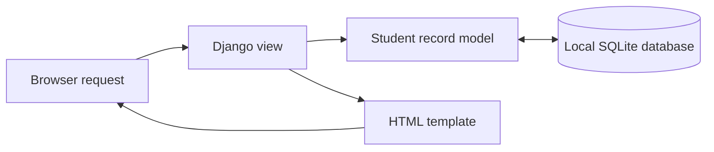

# Django Student Records Demo


An educational Django project demonstrating templates, views, forms, and a SQLite-backed student-record workflow.

## Request flow



## Project layout

```text
toy/
├── manage.py
├── toy/       # Django settings and URL configuration
└── store/     # Views, models, templates, and static assets
```

The repository includes a local SQLite database. Use a fresh local development database for your own run rather than relying on the checked-in database contents.

## Run locally

From the repository root:

```powershell
git clone https://github.com/Sameer-ship-it/DJANGO.git
cd DJANGO\toy
python -m venv .venv
.venv\Scripts\Activate.ps1
python -m pip install django
python manage.py migrate
python manage.py runserver
```

On macOS or Linux, activate with `source .venv/bin/activate`. Then open `http://127.0.0.1:8000/` in a browser.

## Development and privacy notes

- This is a local learning demo, not a production student-information system.
- The project uses development settings. Do not deploy with the checked-in development secret or debug configuration; configure environment-specific secrets and production security settings first.
- Use synthetic student records. Do not enter real student details, passwords, or other personal data into this demo.
- The SQLite database and generated bytecode in the repository are local artifacts; do not use them as a production data store.
